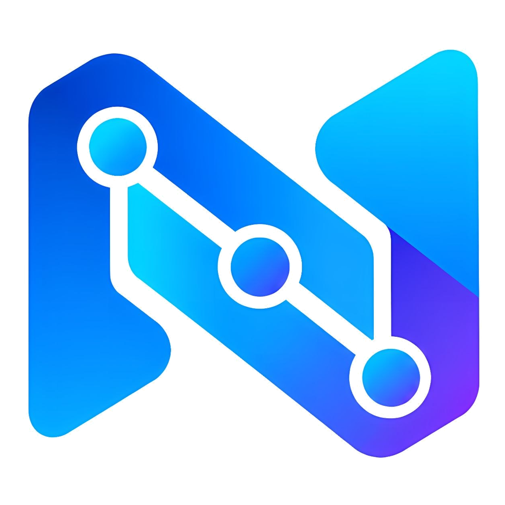

# MIKHMON by NODERA (Desktop & Cloud Standalone Edition)

<p align="center">
  
</p>

<p align="center">
  <b>Language / Langue :</b>
  <a href="README.md"><b>🇮🇩 Bahasa Indonesia</b></a> |
  <a href="README.fr.md"><b>🇫🇷 Français (Côte d'Ivoire / Afrique)</b></a> |
  <a href="README.en.md"><b>🇬🇧 English</b></a>
</p>

<p align="center">
  <a href="https://panel.dgtlnetsolution.com/desktop-licenses"></a>
  <a href="https://panel.dgtlnetsolution.com"></a>
  <a href="https://panel.dgtlnetsolution.com/desktop-licenses"></a>
  <a href="https://panel.dgtlnetsolution.com"></a>
</p>

<p align="center">
  <a href="https://github.com/fitratan/MIKHMON-by-NODERA"></a>
  <a href="https://github.com/fitratan/MIKHMON-by-NODERA/releases"></a>
  <a href="https://github.com/fitratan/MIKHMON-by-NODERA/stargazers"></a>
  <a href="https://github.com/fitratan/MIKHMON-by-NODERA/network/members"></a>
</p>

---

## About MIKHMON by NODERA

**MIKHMON by NODERA** is the next-generation MikroTik hotspot management and billing application, modernly architected and optimized by **NODERA Digital Network**.

Unlike standard legacy Mikhmon (v3/v4) which only serves as a basic API interface for printing vouchers, **MIKHMON by NODERA** is a complete commercial ecosystem: Point of Sale (POS) reseller module, automated mobile payments, multi-provider WhatsApp Gateway, interactive Telegram notifications, and a portable self-contained runtime requiring no XAMPP or third-party web servers.

This software is internationally deployed across Southeast Asia and West Africa (including Côte d'Ivoire).

---

## Comparison: MIKHMON by NODERA vs Legacy Mikhmon (v3/v4)

| Feature / Parameter | Legacy Mikhmon (v3 / v4) | MIKHMON by NODERA (Desktop & VPS Standalone) |
| :--- | :--- | :--- |
| **Server & Runtime** | Requires manual web server / XAMPP setup | Built-in **Portable Micro-Server (PHP 8.2)**, 1-click execution without XAMPP |
| **Reseller POS Module** | None | **Retail POS & Reseller Module** with balance deposits and receipt printing |
| **Automated Payments** | None / Unstable third-party scripts | **Automated Payments & Online Portals** with instant voucher generation upon payment |
| **WhatsApp Gateway** | None | **Multi-Provider WhatsApp Gateway** sends credentials directly to buyers |
| **Telegram Notifications** | Basic plain text alerts | **Interactive Telegram Bot**: sale alerts, revenue recaps, action buttons & expiration alerts |
| **Expired Voucher Alerts** | None | **Real-time Expired Voucher Alert** delivered directly to Telegram technicians |
| **RouterOS Support** | Limited / Frequent errors on RouterOS v7 | **Full RouterOS v6 & v7 Support** with accelerated API connection handling |
| **Thermal Printing** | Standard browser formatting | **Direct USB & Bluetooth Thermal Printing (58mm/80mm)** with crisp layout |
| **License Protection** | Unmanaged / Insecure | **Cloud-Managed HWID License**: self-service HWID resets via client portal |
| **Internationalization** | Indonesian only | **Multilingual (French, Indonesian, English)** with localized West Africa support |

---

## Key Features

### 1. Reseller POS & Retail Agent Module
- Delegate voucher sales to neighborhood kiosks, grocery stores, and local agents.
- Clean, fast POS interface accessible from smartphones, tablets, or laptops.
- Pre-funded reseller balances with automatic profit margin calculation.
- Instant thermal receipt printing directly from the cashier device.

### 2. Multi-Provider WhatsApp Gateway
- Automatically delivers voucher code, username, password, and validity period directly to the customer's WhatsApp upon order completion.
- Broadcasts network maintenance announcements and expiration reminders.

### 3. Interactive Telegram Bot & Expiration Alerts
- **Real-time Sales Alerts**: Immediate notification upon each voucher sale.
- **Voucher Expiration Alerts**: Instant alert when a voucher expires on MikroTik.
- **Daily Recaps**: Automated revenue and hotspot performance summaries.

### 4. Standardized Thermal Printing
- Formatted voucher templates designed specifically for **58mm** and **80mm** thermal printers.
- Supports batch printing with auto-login QR Codes (*Scan to Connect*).
- Customizable branding: logos, watermarks, and footer notices.

### 5. Multi-Router Architecture (ROS v6 & ROS v7)
- Manage multiple remote MikroTik branch routers from a centralized desktop console.
- Supports standard and custom API ports with secured connection tunnels.
- Monitor live traffic bandwidth, interface charts, and DHCP leases in real time.

### 6. Hardware-Bound Licensing & Self-Service HWID
- Protected by cloud-verified Hardware ID (HWID) cryptographic validation.
- **Self-Service HWID Reset**: When transferring to a new computer or laptop, reset your hardware binding directly from the Member Portal without waiting for administrative approval.

---

## Installation & Quick Start

### A. Windows 10 / 11 Installation (Desktop Standalone)
1. **Download the Package**:
   - Download the official ZIP archive from GitHub Releases: **[Download Mikhmon-Desktop.zip](https://github.com/fitratan/MIKHMON-by-NODERA/releases/latest/download/Mikhmon-Desktop.zip)** *(or view all [GitHub Releases](https://github.com/fitratan/MIKHMON-by-NODERA/releases))*
   - Or clone via Git: `git clone https://github.com/fitratan/MIKHMON-by-NODERA.git`
2. **Extract Files**:
   - Extract the entire ZIP archive to your preferred directory (recommended: `C:\Mikhmon-Desktop`).
3. **Launch the App**:
   - Double-click the native executable **`Mikhmon.exe`** (All-in-One Standalone Desktop App).
   - The standalone MIKHMON application window opens immediately (no separate browser tabs or external server launchers required).
   - Use the quick navigation bar at the top-right to toggle between **Hotspot Admin Mode** (Ctrl+1) and **Kiosk / Reseller Portal** (Ctrl+2).
   - *(Optional)* `MikhmonServer.exe` is also provided if you prefer running purely in background system tray server mode.
4. **First-Time Login**:
   - Default credentials: Username `nodera`, Password `nodera`.
5. **Automatic 7-Day Free Trial**:
   - New installations automatically include an unrestricted **7-Day Free Trial**. All modules are immediately unlocked.

---

### B. Linux VPS / Cloud Server Deployment (Ubuntu, Debian, AlmaLinux)

```bash
# 1. Navigate to server web root
cd /var/www/html

# 2. Download and extract source code
wget https://github.com/fitratan/MIKHMON-by-NODERA/archive/refs/heads/main.zip
unzip main.zip
mv MIKHMON-by-NODERA-main mikhmon
rm main.zip

# 3. Configure folder permissions
chown -R www-data:www-data mikhmon
chmod -R 755 mikhmon
```
Access via web browser: `http://YOUR-VPS-IP/mikhmon/login`

---

### C. MikroTik RouterOS v7 Deployment (Native Docker Container)

MIKHMON by NODERA can run directly 24/7 inside your MikroTik router using the official RouterOS v7 **Container (Docker)** feature, eliminating the need for an external computer or server.

#### 📌 Hardware & RouterOS Prerequisites:
1. **RouterOS**: Version `7.4` or higher with the official `container` package installed.
2. **CPU Architecture**: Supports **x86/CHR** (PC Router), **ARM** (hAP ac3, hAP ax2/ax3, cAP ax, L009), or **ARM64** (RB5009, CCR2004, CCR2116). *(Note: MIPSBE/SMIPS architectures like RB750Gr3 are not supported by MikroTik containers)*.
3. **Storage**:
   - **PC x86 / Cloud CHR**: Uses the internal hard drive/SSD (no external USB required).
   - **Physical RouterBOARD (RB / hAP / CCR)**: Recommended to use an external USB Flash Drive / SSD (formatted in `ext4` via *System > Disks*, e.g., named `usb1`) to preserve internal flash endurance.

---

#### ⚡ Quick Option: 1-Click Full Installer (Includes 24/7 Watchdog & Auto-Start)

For a fully automated deployment from start to finish (Bridge, VETH, NAT, Mount Folder, Container Image Download, Port Forwarding, plus Auto-Start upon reboot and 24/7 Watchdog):

* **For PC Router x86 / Cloud CHR:**
  ```routeros
  /tool fetch url="https://raw.githubusercontent.com/fitratan/MIKHMON-by-NODERA/main/scripts/install-container-x86.rsc" dst-path=install.rsc; /import install.rsc
  ```

* **For Physical RouterBOARD (using USB Flash Drive / SSD `usb1`):**
  ```routeros
  /tool fetch url="https://raw.githubusercontent.com/fitratan/MIKHMON-by-NODERA/main/scripts/install-container-usb.rsc" dst-path=install.rsc; /import install.rsc
  ```

---

#### 🚀 Step-by-Step Manual Installation (MikroTik CLI Terminal):

##### 1. Enable Container Mode on MikroTik:
```routeros
/system device-mode update container=yes
```
> **Physical Confirmation**: On physical hardware routers, RouterOS will prompt you to press the router's physical *Reset button* or power cycle within 5 minutes to confirm. On CHR / PC x86, it applies immediately.

##### 2. Configure Virtual Ethernet (VETH) & Container Bridge:
```routeros
# Create dedicated container bridge
/interface bridge add name=dockers comment="Mikhmon Container Bridge"
/ip address add address=172.17.0.1/24 interface=dockers

# Create Virtual Ethernet (VETH) interface
/interface veth add name=veth-mikhmon address=172.17.0.2/24 gateway=172.17.0.1
/interface bridge port add bridge=dockers interface=veth-mikhmon

# Enable NAT Masquerade so the container has internet access (for cloud licensing & Telegram/WA notifications)
/ip firewall nat add chain=srcnat action=masquerade src-address=172.17.0.0/24 comment="Masquerade Mikhmon Container"
```

##### 3. Create Mount Directory (To Persist License & Router Configurations):
* **For PC Router x86 / CHR (Internal SSD Storage):**
  ```routeros
  /container mounts add list=mikhmon_config src=mikhmon/config dst=/app/mikhmon/config
  ```
* **For Physical RouterBOARD (Using External USB `usb1`):**
  ```routeros
  /container mounts add list=mikhmon_config src=usb1/mikhmon/config dst=/app/mikhmon/config
  ```
> *(Note: On older RouterOS v7 builds prior to v7.14, if a bad parameter error appears on `list=`, use `name=mikhmon_config`).*

##### 4. Download Official Image Directly from GitHub:
Use the official `/tool fetch` command from GitHub (free from registry timeout issues):
* **For PC Router x86 / CHR:**
  ```routeros
  /tool fetch url="https://raw.githubusercontent.com/fitratan/MIKHMON-by-NODERA/container-release/mikhmon-x86.tar.gz" dst-path="mikhmon.tar.gz" mode=https
  ```
* **For Physical RouterBOARD (Save to USB `usb1`):**
  ```routeros
  /tool fetch url="https://raw.githubusercontent.com/fitratan/MIKHMON-by-NODERA/container-release/mikhmon-x86.tar.gz" dst-path="usb1/mikhmon.tar.gz" mode=https
  ```
*(Wait for download progress in terminal until status shows `finished`)*.

##### 5. Install & Run Mikhmon Container:
* **For PC Router x86 / CHR:**
  ```routeros
  /container add file=mikhmon.tar.gz interface=veth-mikhmon root-dir=mikhmon mountlists=mikhmon_config logging=yes start-on-boot=yes
  ```
* **For Physical RouterBOARD (USB `usb1`):**
  ```routeros
  /container add file=usb1/mikhmon.tar.gz interface=veth-mikhmon root-dir=usb1/mikhmon mountlists=mikhmon_config logging=yes start-on-boot=yes
  ```

Wait a few seconds for extraction, then verify status:
```routeros
/container print
```
Once status changes to **`S` (STOPPED)**, start the container:
```routeros
/container start [find interface=veth-mikhmon]
```
Status will switch to **`R` (RUNNING)**! 🎉

##### 6. Auto-Start & 24/7 Watchdog Setup (MANDATORY for Router Reboot / Power Loss):
> **⚠️ IMPORTANT**: By default, MikroTik containers may stay in the `STOPPED` state after router reboot or power loss (especially on physical RouterBOARD models where external USB storage `usb1` needs 5–15 seconds to mount).
>
> Configure the following in MikroTik Terminal to ensure Mikhmon **automatically starts upon router boot** and stays running 24/7:

###### Option A: 1-Line Terminal Command (Recommended Fast Method)
Run this command in WinBox Terminal to download and apply the official auto-start script:
```routeros
/tool fetch url="https://raw.githubusercontent.com/fitratan/MIKHMON-by-NODERA/main/scripts/autostart-mikhmon.rsc" dst-path=autostart.rsc; /import autostart.rsc
```

###### Option B: Manual Copy & Paste into Terminal
Alternatively, paste this complete RouterOS script into Terminal:
```routeros
# 1. Enable start-on-boot property on Mikhmon container
/container set [find interface=veth-mikhmon] start-on-boot=yes

# 2. Remove old schedulers if existing
/system scheduler remove [find name="AutoStart-Mikhmon"]
/system scheduler remove [find name="Watchdog-Mikhmon"]

# 3. Add Auto-Start Scheduler upon Startup (with 15s delay to allow USB/SSD storage mount)
/system scheduler add name="AutoStart-Mikhmon" start-time=startup interval=0s \
    on-event=":delay 15s; :log info \"[Mikhmon AutoStart] Starting container post-boot...\"; /container start [find interface=veth-mikhmon];" \
    comment="Auto-start Mikhmon Container on MikroTik Boot (NODERA)"

# 4. Add 24/7 Watchdog Scheduler (checks every 1 min and revives container if offline)
/system scheduler add name="Watchdog-Mikhmon" interval=1m \
    on-event=":if ([:len [/container find interface=veth-mikhmon status=running]] = 0) do={ :log warning \"[Mikhmon Watchdog] Container offline! Reviving...\"; /container start [find interface=veth-mikhmon]; }" \
    comment="Watchdog to keep Mikhmon Container Running 24/7 (NODERA)"

# 5. Start container right now if currently stopped
:if ([:len [/container find interface=veth-mikhmon status=running]] = 0) do={
    /container start [find interface=veth-mikhmon];
}
```
*(Pre-built script file is also available at: [`scripts/autostart-mikhmon.rsc`](scripts/autostart-mikhmon.rsc))*.

##### 7. Add Port Forwarding (DST-NAT) for Web Access:
To access Mikhmon from your PC/smartphone on the local network via port `8082`:
```routeros
/ip firewall nat add chain=dstnat dst-port=8082 protocol=tcp action=dst-nat to-addresses=172.17.0.2 to-ports=8080 comment="Mikhmon NODERA Web Access"
```

Access Mikhmon via browser:
👉 **`http://MIKROTIK-ROUTER-IP:8082`** *(e.g., `http://192.168.88.1:8082`)*

---

#### 🔑 Router Connection & License Activation:
1. **MikroTik Router Connection**:
   - Inside Mikhmon router settings, enter the Container Gateway IP: **`172.17.0.1`** (API Port: `8728`).
   - Ensure the API service is enabled on MikroTik (`/ip service enable api`).
2. **License & HWID Activation**:
   - The login page will automatically detect the **Container HWID** and persist it to `config/.hwid`.
   - Default credentials: username `nodera`, password `nodera`.
   - Automatically enjoys a **7-Day Free Trial**, or activate your license key purchased from [panel.dgtlnetsolution.com](https://panel.dgtlnetsolution.com).

---

#### 🔄 How to Update Mikhmon Inside the Container:

Mikhmon running inside a MikroTik Docker Container **can easily be updated** without losing your router session configurations or license:

##### Method 1: 1-Click Update from the Mikhmon Web UI (Most Recommended)
1. Open Mikhmon via your browser (`http://MIKROTIK-IP:8082`).
2. Navigate to **System Update** (the refresh icon on the menu or navigate to `admin.php?id=update`).
3. Click **"Check for Updates"** to fetch the latest version and commits from GitHub.
4. Click **"Update Now (1-Click)"**. The container's PHP engine will download the latest codebase from GitHub and apply it on-the-fly.
5. **Zero Data Loss Guarantee**: Your router configurations (`include/config.php`), HWID & license files (`config/`), and custom voucher templates (`template/`) are strictly preserved.

##### Method 2: Update Container Image via MikroTik Terminal
If a major container image update is released (e.g. newer PHP runtime):
1. Stop and remove old container:
   ```routeros
   /container stop [find interface=veth-mikhmon]
   /container remove [find interface=veth-mikhmon]
   ```
2. Download latest image and recreate:
   * **Option A: For PC Router x86 / Cloud CHR / Internal Storage (No USB):**
     ```routeros
     /tool fetch url="https://raw.githubusercontent.com/fitratan/MIKHMON-by-NODERA/container-release/mikhmon-x86.tar.gz" dst-path="mikhmon.tar.gz" mode=https
     /container add file=mikhmon.tar.gz interface=veth-mikhmon root-dir=mikhmon mountlists=mikhmon_config logging=yes start-on-boot=yes
     /container start [find interface=veth-mikhmon]
     ```
   * **Option B: For Physical RouterBOARD (using USB Flash Drive / SSD `usb1`):**
     ```routeros
     /tool fetch url="https://raw.githubusercontent.com/fitratan/MIKHMON-by-NODERA/container-release/mikhmon-x86.tar.gz" dst-path="usb1/mikhmon.tar.gz" mode=https
     /container add file=usb1/mikhmon.tar.gz interface=veth-mikhmon root-dir=usb1/mikhmon mountlists=mikhmon_config logging=yes start-on-boot=yes
     /container start [find interface=veth-mikhmon]
     ```
   *(Your license and configurations remain intact because they are stored in the mounted storage `mikhmon/config` or `usb1/mikhmon/config`)*.

---

## Default Login Credentials

| Parameter | Default Value | Description |
| :--- | :--- | :--- |
| **Local URL** | `http://127.0.0.1:8080` | Built-in PHP 8.2 micro-server local port |
| **Username** | `nodera` | Primary administrator account |
| **Password** | `nodera` | Default factory password |

---

## Official Licensing & Support Contacts

Official **Mikhmon Desktop Standalone** licenses can be purchased and managed at:

- **Customer Portal**: [panel.dgtlnetsolution.com](https://panel.dgtlnetsolution.com)
- **WhatsApp Support (Côte d'Ivoire)**: **+255 07 88 22 26 99**
- **WhatsApp Support (Indonesia)**: **0851-5517-3547**
- **Telegram**: [@nullneko_exe](https://t.me/nullneko_exe)

---

## System Requirements

- **Operating System**: Windows 10 / Windows 11 (64-bit), Linux Server, or MikroTik RouterOS v7.4+
- **Processor**: Dual Core 1.5 GHz or higher / MikroTik ARM, ARM64, or x86 architecture
- **RAM**: 2 GB minimum for PC/Server, or MikroTik router with 512 MB+ RAM (1 GB+ recommended)
- **Storage**: 500 MB free space (or external USB/SSD storage on MikroTik)
- **Internet Connection**: Required during initial license activation and gateway synchronization

---

<p align="center">
  <b>NODERA</b><br>
  Digital Network Solution<br>
  <i>Copyright &copy; 2026 NODERA. All Rights Reserved.</i>
</p>
