# MIKHMON by NODERA

<p align="center">
  
</p>

<p align="center">
  <b>Bahasa / Language / Langue :</b>
  <a href="README.md"><b>🇮🇩 Bahasa Indonesia</b></a> |
  <a href="README.fr.md"><b>🇫🇷 Français (Côte d'Ivoire / Afrique)</b></a> |
  <a href="README.en.md"><b>🇬🇧 English</b></a>
</p>

<p align="center">
  <a href="https://panel.dgtlnetsolution.com/desktop-licenses"></a>
  <a href="https://panel.dgtlnetsolution.com"></a>
  <a href="https://panel.dgtlnetsolution.com/desktop-licenses"></a>
  <a href="https://panel.dgtlnetsolution.com"></a>
</p>

<p align="center">
  <a href="https://github.com/fitratan/MIKHMON-by-NODERA"></a>
  <a href="https://github.com/fitratan/MIKHMON-by-NODERA/releases"></a>
  <a href="https://github.com/fitratan/MIKHMON-by-NODERA/stargazers"></a>
  <a href="https://github.com/fitratan/MIKHMON-by-NODERA/network/members"></a>
</p>

---

## Tentang MIKHMON by NODERA

**MIKHMON by NODERA** adalah generasi baru aplikasi manajemen hotspot dan billing MikroTik yang dikembangkan dan dioptimalkan secara modern oleh **NODERA Team**. 

Berbeda dengan Mikhmon biasa (legacy v3/v4) yang hanya berfungsi sebagai antarmuka API dasar untuk cetak voucher, **MIKHMON by NODERA** dibangun menjadi ekosistem penjualan voucher yang lengkap dengan modul kasir warung, pembayaran QRIS otomatis, integrasi WhatsApp Gateway, notifikasi Telegram interaktif, **Manajemen FUP (Fair Usage Policy) Engine**, **Monitoring Trafik Interface & Bandwidth Real-Time**, serta runtime portable terisolasi tanpa memerlukan XAMPP atau instalasi web server eksternal.

---

## Perbandingan: MIKHMON by NODERA vs Mikhmon Biasa (Legacy v3/v4)

Berikut adalah tabel perbedaan mendasar antara **MIKHMON by NODERA** dengan versi Mikhmon umum di pasaran:

| Fitur / Parameter | Mikhmon Biasa (Legacy v3 / v4) | MIKHMON by NODERA (Desktop & VPS Standalone) |
| :--- | :--- | :--- |
| **Server & Runtime** | Butuh install Web Server / XAMPP manual | **Portable Micro-Server (PHP 8.2)** built-in, 1-klik jalan tanpa XAMPP |
| **Modul Warung POS** | Tidak ada | **Modul Kasir Warung & Agen Kulakan** lengkap dengan saldo deposit & cetak struk |
| **Payment Gateway QRIS** | Tidak ada / Perlu script pihak ketiga | **NODERA Pay Dynamic QRIS** otomatis generate voucher instan saat lunas |
| **WhatsApp Gateway** | Tidak ada | **Multi-Provider WA Gateway** otomatis kirim voucher langsung ke nomor WA pembeli |
| **Notifikasi Telegram** | Terbatas pada notif login teks biasa | **Telegram Bot Interaktif**: Notif login, rekap omset, tombol **Accept/Reject**, & **Alert Voucher Expired** |
| **FUP Engine & Throttling** | Tidak ada / Manual | **FUP Engine**: Atur threshold kuota, kecepatan setelah FUP, & siklus reset mandiri |
| **Monitoring Interface & Trafik**| Standar router dasar | **Advanced Interface Bandwidth Telemetry** (Rx/Tx terperinci, total TB, & status running) |
| **Dukungan RouterOS** | Terbatas / Sering error pada RouterOS v7 | **Full Support RouterOS v6 & v7** dengan optimasi koneksi API cepat |
| **Cetak Struk Thermal** | Format kertas browser standar | **Direct Bluetooth & USB Thermal Print (58mm/80mm)** dengan format struk rapi |
| **Sistem Lisensi & Proteksi** | Gratisan / Tidak terkelola | **Cloud-Managed HWID License**: Reset HWID mandiri via Cloud Panel saat ganti PC |
| **Pembaruan & Ekosistem** | Proyek legacy (jarang update) | **Terhubung langsung dengan Cloud Panel NODERA** dan update fitur berkala |

---

## Fitur Unggulan MIKHMON by NODERA

### 1. Modul Kasir Warung POS & Reseller Kulakan
- Memungkinkan Anda menitipkan penjualan voucher ke warung, toko kelontong, atau reseller setempat.
- Antarmuka kasir warung yang sangat sederhana dan cepat diakses melalui HP atau laptop kasir.
- Sistem saldo deposit warung dengan perhitungan laba otomatis.
- Cetak struk penjualan langsung ke printer thermal kasir.

### 2. NODERA Pay Dynamic QRIS & Checkout Otomatis
- Pelanggan hotspot dapat membeli voucher secara mandiri melalui portal pembelian.
- Menampilkan QRIS dinamis real-time dengan nominal pas (bebas konfirmasi manual).
- Setelah pembayaran berhasil via GoPay, OVO, Dana, ShopeePay, BCA, atau Mobile Banking lainnya, sistem langsung membuat voucher di MikroTik dan menampilkannya di layar pembeli.

### 3. WhatsApp Gateway Multi-Provider
- Mengirimkan kode voucher, username, password, dan masa aktif langsung ke nomor WhatsApp pelanggan begitu transaksi selesai.
- Pengingat masa aktif voucher dan informasi gangguan jaringan broadcast ke pelanggan.

### 4. Telegram Interactive Bot & Expired Alert
- **Notifikasi Penjualan Real-time**: Laporan masuk setiap kali ada voucher terjual.
- **Alert Voucher Expired**: Notifikasi instan saat voucher pengguna habis masa aktifnya di MikroTik lengkap dengan username, profil, dan waktu kedaluwarsa.
- **Tombol Aksi Cepat**: Tombol *Accept* / *Reject* pesanan langsung dari jendela chat Telegram.
- **Laporan Harian**: Rekap omset dan statistik penjualan harian hotspot secara otomatis.

### 5. FUP (Fair Usage Policy) Engine & Auto-Throttling
- **Fungsi & Kegunaan**: Mencegah monopoli bandwidth oleh pengguna berat (*heavy downloader*). Sistem melacak akumulasi pemakaian kuota per profil hotspot secara akurat.
- **Konfigurasi Threshold Kuota**: Menentukan batas pemakaian wajar (*quota threshold*, misal 10 GB) sebelum pembatasan berlaku.
- **Otomatisasi Throttling**: Ketika kuota FUP terlampaui, sistem otomatis menurunkan kecepatan akses internet pelanggan (misal ke 1M/1M) tanpa memutus sesi aktif, menjaga keadilan distribusi bandwidth bagi seluruh pengguna.
- **Siklus Reset Fleksibel**: Pengaturan jadwal reset pemakaian kuota secara berkala (Manual atau Otomatis) sesuai kebutuhan operasional RT/RW Net.

### 6. Advanced Interface Bandwidth & Traffic Telemetry
- **Fungsi & Kegunaan**: Memantau kesehatan link jaringan dan beban trafik router secara menyeluruh dari satu layar terpusat.
- **Rincian Rx / Tx Terperinci**: Memantau akumulasi trafik Download (Rx) dan Upload (Tx) dalam skala besar (hingga skala Terabyte / TB).
- **Monitoring Status Interface**: Memeriksa status operasional setiap interface fisik maupun virtual (`1_SFP_METRO`, `5_OM_BUDI`, `6_UPLINK_2`, dll.) secara real-time untuk mendeteksi gangguan atau lonjakan trafik anomali secara dini.

### 7. Thermal Printing Terstandarisasi
- Desain template voucher yang presisi untuk printer thermal ukuran **58mm** dan **80mm**.
- Mendukung cetak massal (batch print) dengan QR Code auto-login (*Scan to Connect*).
- Kustomisasi logo, watermark, dan catatan kaki (*footer*) voucher.

### 8. Multi-Router Architecture (ROS v6 & ROS v7)
- Kelola banyak router MikroTik cabang dari satu aplikasi desktop terpusat.
- Mendukung port API standar maupun port kustom dengan keamanan koneksi tinggi.
- Monitor traffic real-time, grafik interface, dan status DHCP Leases langsung dari dashboard.

### 9. Keamanan Lisensi & Manajemen HWID Mandiri
- Dilindungi sistem verifikasi Hardware ID (HWID) berbasis cloud dengan tanda tangan digital kriptografi.
- **Fitur Reset HWID Mandiri**: Jika Anda mengganti laptop atau komputer kasir, Anda dapat mereset ikatan HWID langsung dari Member Panel tanpa harus menghubungi admin.

---

## Preview Antarmuka Desktop (PC / Laptop View)

Tampilan antarmuka desktop **MIKHMON by NODERA** yang responsif, bersih, dan modern:

### 1. Telemetri Interface & FUP (Fair Usage Policy) Engine
| Advanced Interface Bandwidth Telemetry | Pengaturan FUP Engine (Fair Usage Policy) |
| :---: | :---: |
| 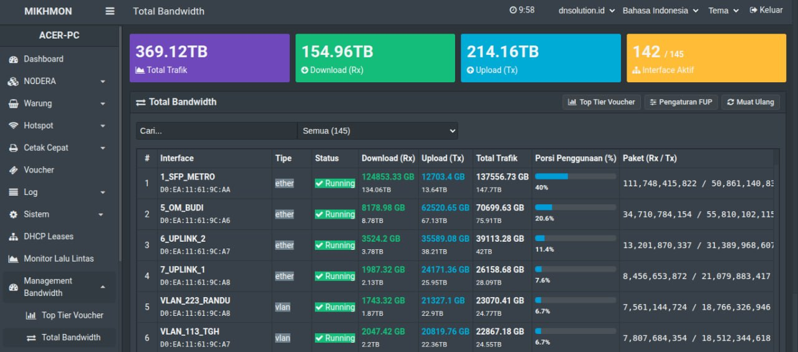 | 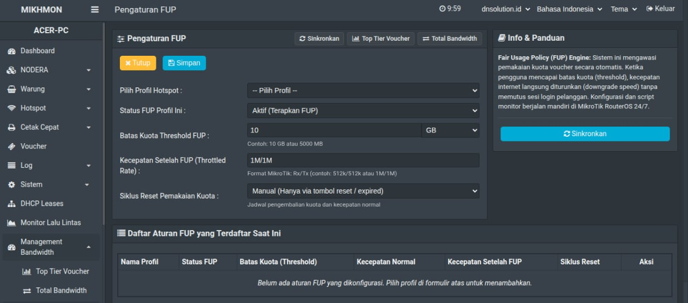 |
| *Monitoring interface jaringan tingkat lanjut: Total Trafik (369.12 TB), Download Rx (154.96 TB), Upload Tx (214.16 TB), & 142/145 Interface Aktif* | *Panel FUP: Pemilihan Profil Hotspot, Status FUP Profil, Threshold Batas Kuota (10 GB), Kecepatan Setelah FUP (1M/1M), & Siklus Reset Kuota* |

### 2. Ekosistem Warung POS & Reseller Kulakan
| Manajemen Mitra Warung (Admin) | Dashboard Kasir Warung (Reseller) |
| :---: | :---: |
| 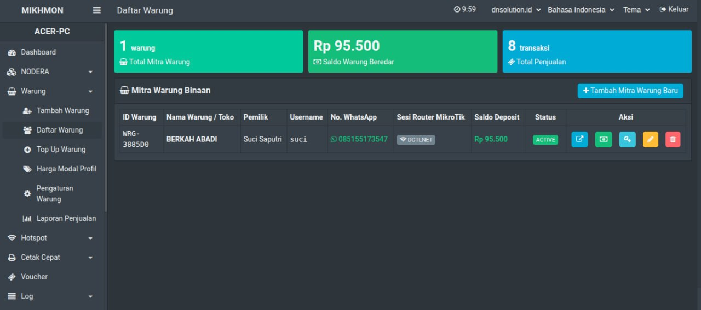 | 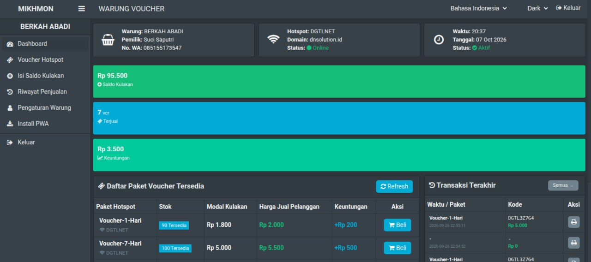 |
| *Daftar warung mitra, monitoring saldo beredar, & kontrol akun* | *Panel kasir warung, stok paket voucher, & riwayat penjualan* |

| Modal Checkout Voucher (Kasir) | Struk Penjualan & QR Code (Kasir) |
| :---: | :---: |
| 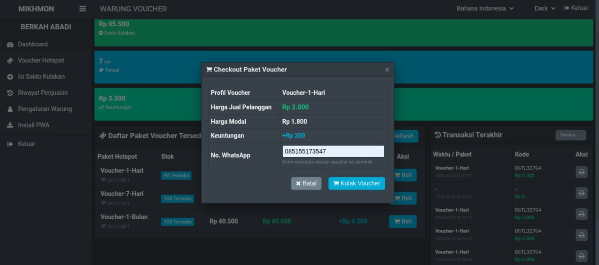 | 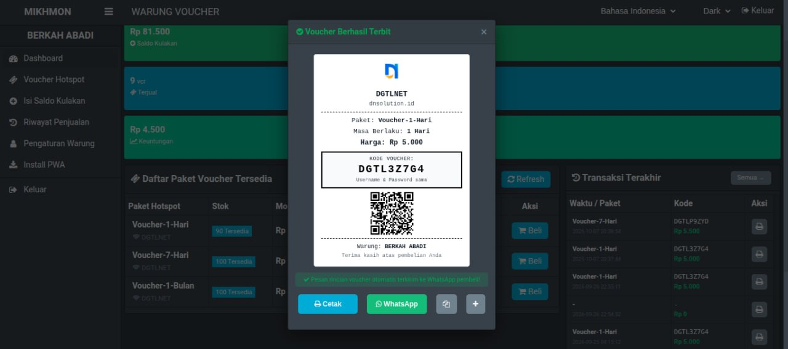 |
| *Rincian harga modal, harga jual, margin laba, & input WA pembeli* | *Struk instan dengan QR Code autologin, tombol cetak, & kirim WA* |

### 3. Integrasi Gateway Otomatisasi (WhatsApp & Telegram)
| WhatsApp Gateway Multi-Provider | Bot & Notifikasi Telegram Interaktif |
| :---: | :---: |
| 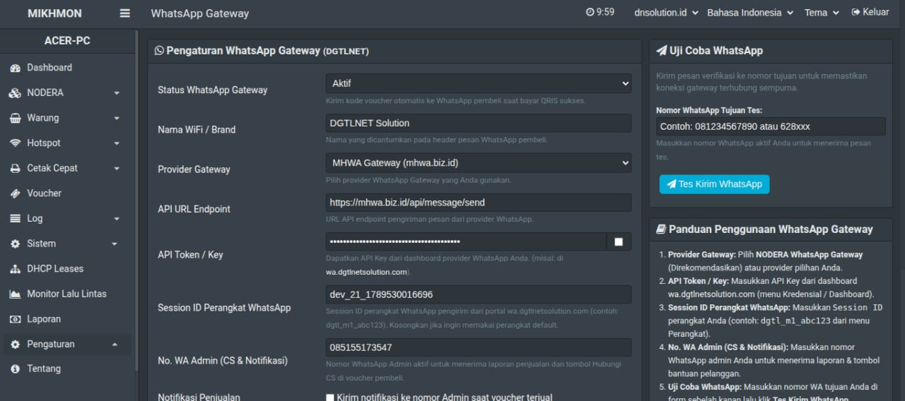 | 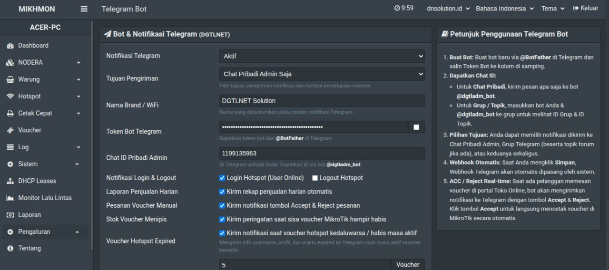 |
| *Konfigurasi endpoint, session ID, template pesan, & tes kirim* | *Alert voucher expired, rekap omset, order manual, & tombol respon* |

---

## Tangkapan Layar & Preview Fitur (Mobile Interface)

Berikut adalah beberapa tampilan antarmuka fitur utama **MIKHMON by NODERA** yang dioptimalkan untuk perangkat mobile dan desktop:

| Dashboard & Telemetri MikroTik | Navigasi Sidebar & Modul Warung POS |
| :---: | :---: |
| 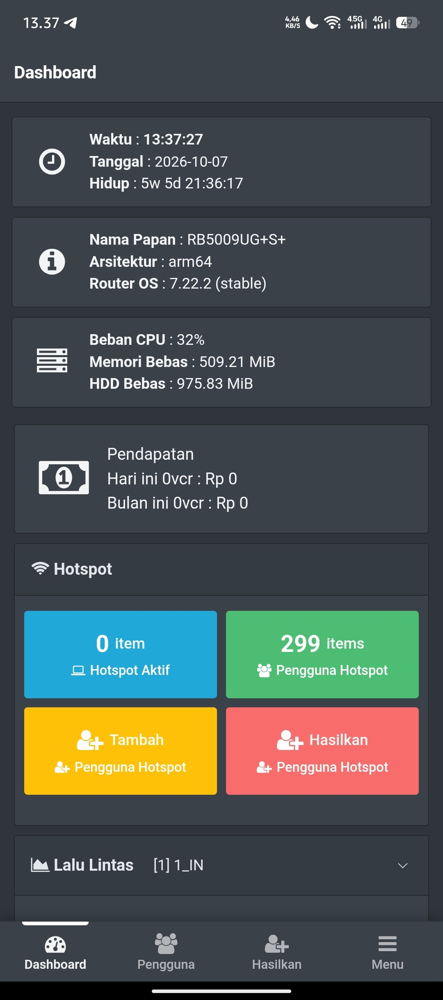 | 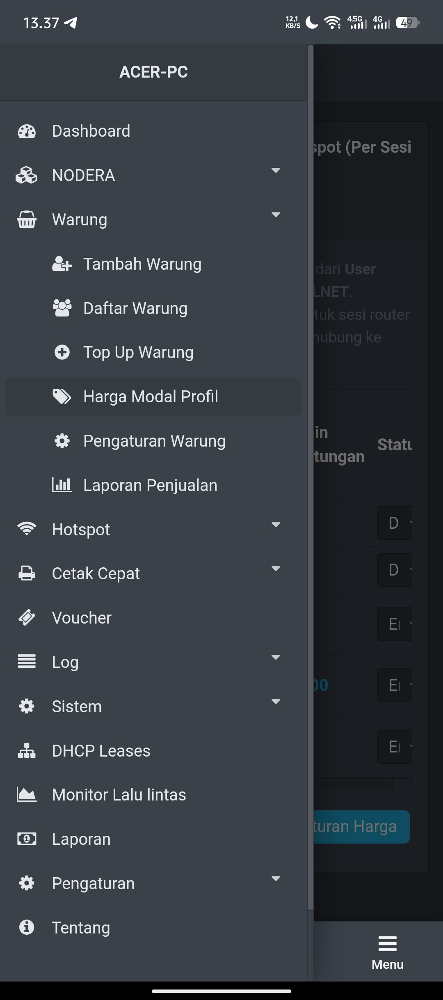 |
| *Status CPU, RAM, Uptime MikroTik & Statistik Hotspot* | *Menu lengkap terintegrasi Warung, Cetak Cepat, & Gateway* |

| Manajemen Mitra Warung & Saldo POS | Katalog Desain Template Voucher |
| :---: | :---: |
| 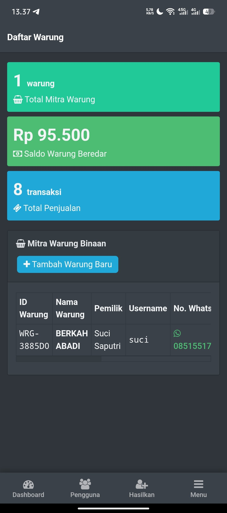 | 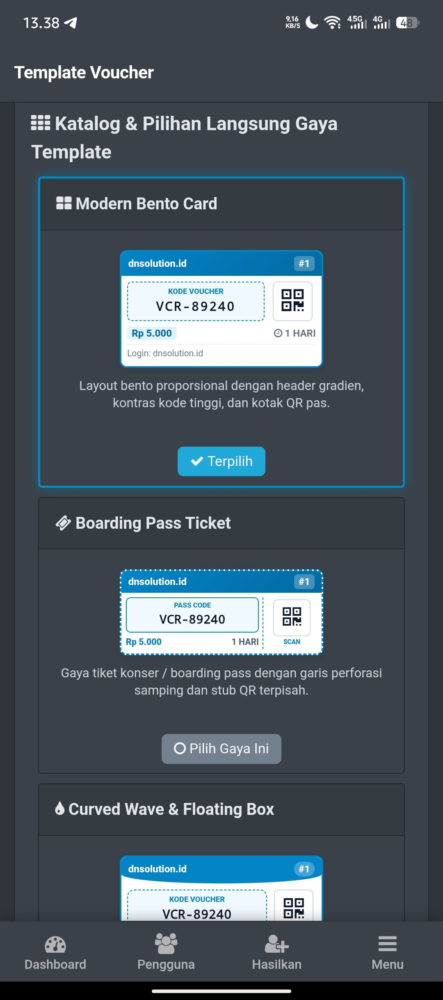 |
| *Daftar warung mitra, monitoring saldo deposit & mutasi transaksi* | *Pilihan layout voucher: Modern Bento, Boarding Pass, Curved Wave* |

| Pilihan Tema Toko Pembelian Online | NODERA Pay Dynamic QRIS Gateway |
| :---: | :---: |
| 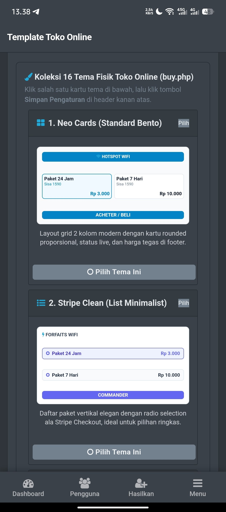 | 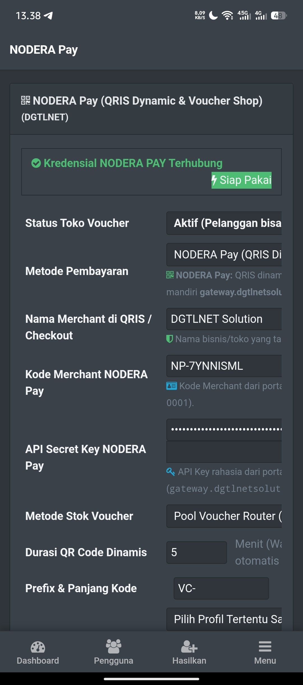 |
| *Pilihan layout halaman pembelian voucher mandiri oleh pelanggan* | *Pengaturan Dynamic QRIS, durasi bayar, & auto generate voucher* |

| Bot & Notifikasi Telegram Interaktif | Integrasi WhatsApp Gateway |
| :---: | :---: |
| 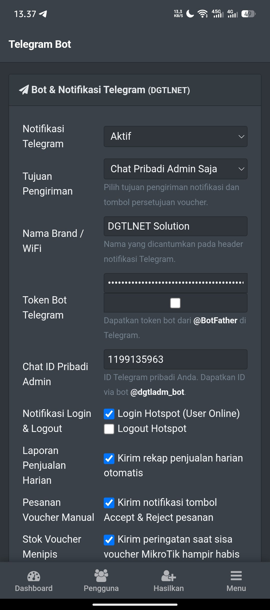 | 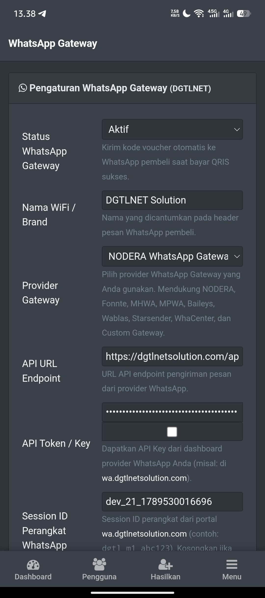 |
| *Notifikasi penjualan, alert voucher expired, & rekap omset harian* | *Kirim otomatis kode voucher & info login langsung ke WA pembeli* |

---

## Cara Instalasi & Penggunaan

### A. Instalasi di Windows 10 / 11 (Desktop Standalone)
1. **Unduh Paket Aplikasi**:
   - Download file ZIP installer resmi langsung dari GitHub Releases: **[Download Mikhmon-Desktop.zip](https://github.com/fitratan/MIKHMON-by-NODERA/releases/latest/download/Mikhmon-Desktop.zip)** *(atau via halaman [GitHub Releases](https://github.com/fitratan/MIKHMON-by-NODERA/releases))*
   - Atau clone repository: `git clone https://github.com/fitratan/MIKHMON-by-NODERA.git`
2. **Ekstrak File**:
   - Ekstrak seluruh isi file ZIP ke folder pilihan Anda di laptop/PC (rekomendasi: `C:\Mikhmon-Desktop` atau `D:\Mikhmon-Desktop`).
3. **Jalankan Aplikasi**:
   - Buka folder hasil ekstrak, lalu klik ganda file executable **`Mikhmon.exe`** (All-in-One Standalone Desktop App).
   - Jendela aplikasi mandiri MIKHMON langsung terbuka di layar (tanpa perlu membuka browser Chrome manual dan tanpa jendela server terpisah).
   - Gunakan tombol cepat di navigasi kanan atas untuk berpindah antara **Mode Hotspot Admin** (Ctrl+1) dan **Portal Kasir Warung** (Ctrl+2).
   - *(Opsional)* File `MikhmonServer.exe` tetap disediakan jika ingin menjalankan mode server background saja.
4. **Login Pertama Kali**:
   - Masuk dengan kredensial default: Username `nodera`, Password `nodera`.
5. **Masa Percobaan 7 Hari Gratis (Auto Trial)**:
   - Setiap download baru otomatis mendapatkan **Free Trial 7 Hari** tanpa perlu memasukkan License Key di awal. Seluruh fitur sudah langsung terbuka penuh.

---

### B. Instalasi di Linux VPS / Cloud Server (Ubuntu, Debian, AlmaLinux)

Mikhmon by NODERA dapat di-deploy langsung di VPS Linux menggunakan Web Server (Nginx/Apache) ataupun PHP Standalone Server:

#### 1. Cara Web Server (Nginx / Apache / aaPanel):
```bash
# 1. Masuk ke direktori web root server
cd /var/www/html

# 2. Download dan ekstrak source code
wget https://github.com/fitratan/MIKHMON-by-NODERA/archive/refs/heads/main.zip
unzip main.zip
mv MIKHMON-by-NODERA-main mikhmon
rm main.zip

# 3. Atur izin akses direktori untuk penyimpanan konfigurasi router
chown -R www-data:www-data mikhmon
chmod -R 755 mikhmon
```
Akses melalui browser: `http://IP-VPS-ANDA/mikhmon/login`

#### 2. Cara Cepat Standalone (PHP Built-in Server):
```bash
# 1. Masuk folder mikhmon
cd /root/mikhmon

# 2. Jalankan background service pada port 8080
php -S 0.0.0.0:8080
```
Akses melalui browser: `http://IP-VPS-ANDA:8080/login`

---

### C. Instalasi di MikroTik RouterOS v7 (Docker Container Native)

Mikhmon by NODERA dapat dijalankan secara langsung 24/7 di dalam router MikroTik menggunakan fitur resmi **Container (Docker)** RouterOS v7 tanpa perlu PC atau server terpisah.

#### 📌 Prasyarat Hardware & RouterOS:
1. **RouterOS**: Versi `7.4` atau lebih baru dengan package `container` terpasang.
2. **Arsitektur CPU**: Mendukung **x86/CHR** (PC Router), **ARM** (hAP ac3, hAP ax2/ax3, cAP ax, L009), atau **ARM64** (RB5009, CCR2004, CCR2116). *(Catatan: Perangkat berbasis MIPSBE/SMIPS seperti RB750Gr3 tidak mendukung fitur container MikroTik)*.
3. **Penyimpanan**:
   - **PC x86 / Cloud CHR**: Menggunakan harddisk/SSD bawaan router (tidak butuh USB eksternal).
   - **RouterBOARD Fisik (RB / hAP / CCR)**: Wajib menggunakan Flashdisk / SSD USB eksternal (format `ext4` via *System > Disks*, misal bernama `usb1`) agar flash internal router tidak cepat aus.

---

#### ⚡ Opsi Cepat: 1-Klik Full Installer (Termasuk Auto-Start & Watchdog 24/7)

Jika Anda ingin instalasi instan dari awal sampai selesai (konfigurasi Bridge, VETH, NAT, Mount Folder, Download Container Image, Port Forwarding, hingga Auto-Start saat reboot dan Watchdog 24/7):

* **Untuk PC Router x86 / Cloud CHR:**
  ```routeros
  /tool fetch url="https://raw.githubusercontent.com/fitratan/MIKHMON-by-NODERA/main/scripts/install-container-x86.rsc" dst-path=install.rsc; /import install.rsc
  ```

* **Untuk RouterBOARD Fisik (Menggunakan Flashdisk / SSD USB `usb1`):**
  ```routeros
  /tool fetch url="https://raw.githubusercontent.com/fitratan/MIKHMON-by-NODERA/main/scripts/install-container-usb.rsc" dst-path=install.rsc; /import install.rsc
  ```

---

#### 🚀 Langkah-Langkah Instalasi Manual (MikroTik Terminal CLI):

##### 1. Aktifkan Mode Container di MikroTik:
```routeros
/system device-mode update container=yes
```
> **Catatan Fisik**: Pada router fisik, MikroTik akan meminta Anda menekan tombol *Reset fisik router* atau mencabut-colok kabel power dalam batas waktu 5 menit untuk konfirmasi keamanan. Pada CHR / PC x86, perintah langsung aktif.

##### 2. Konfigurasi Jaringan & Bridge Virtual Container:
```routeros
# Buat Bridge khusus container
/interface bridge add name=dockers comment="Bridge Container Mikhmon"
/ip address add address=172.17.0.1/24 interface=dockers

# Buat Virtual Ethernet (VETH) untuk Container Mikhmon
/interface veth add name=veth-mikhmon address=172.17.0.2/24 gateway=172.17.0.1
/interface bridge port add bridge=dockers interface=veth-mikhmon

# Aktifkan NAT Masquerade agar container dapat mengakses internet (validasi lisensi & gateway WA/Telegram)
/ip firewall nat add chain=srcnat action=masquerade src-address=172.17.0.0/24 comment="Masquerade Container Mikhmon"
```

##### 3. Buat Folder Mount (Agar Lisensi & Konfigurasi Router Tersimpan Permanen):
* **Untuk PC Router x86 / CHR (Penyimpanan Internal SSD):**
  ```routeros
  /container mounts add list=mikhmon_config src=mikhmon/config dst=/app/mikhmon/config
  ```
* **Untuk RouterBOARD Fisik (Menggunakan USB Flashdisk `usb1`):**
  ```routeros
  /container mounts add list=mikhmon_config src=usb1/mikhmon/config dst=/app/mikhmon/config
  ```
> *(Catatan: Pada RouterOS v7 versi lama sebelum v7.14, jika muncul error bad parameter pada `list=`, gunakan `name=mikhmon_config`).*

##### 4. Download Image Resmi Langsung dari GitHub:
Gunakan perintah `/tool fetch` resmi dari GitHub (bebas limit timeout registry):
* **Untuk PC Router x86 / CHR:**
  ```routeros
  /tool fetch url="https://raw.githubusercontent.com/fitratan/MIKHMON-by-NODERA/container-release/mikhmon-x86.tar.gz" dst-path="mikhmon.tar.gz" mode=https
  ```
* **Untuk RouterBOARD Fisik (Simpan ke USB `usb1`):**
  ```routeros
  /tool fetch url="https://raw.githubusercontent.com/fitratan/MIKHMON-by-NODERA/container-release/mikhmon-x86.tar.gz" dst-path="usb1/mikhmon.tar.gz" mode=https
  ```
*(Tunggu progres download di terminal sampai statusnya `finished`)*.

##### 5. Pasang & Jalankan Container:
* **Untuk PC Router x86 / CHR:**
  ```routeros
  /container add file=mikhmon.tar.gz interface=veth-mikhmon root-dir=mikhmon mountlists=mikhmon_config logging=yes start-on-boot=yes
  ```
* **Untuk RouterBOARD Fisik (USB `usb1`):**
  ```routeros
  /container add file=usb1/mikhmon.tar.gz interface=veth-mikhmon root-dir=usb1/mikhmon mountlists=mikhmon_config logging=yes start-on-boot=yes
  ```

Tunggu beberapa detik proses ekstraksi file, lalu cek statusnya:
```routeros
/container print
```
Setelah statusnya menjadi **`S` (STOPPED)**, langsung nyalakan containernya:
```routeros
/container start [find interface=veth-mikhmon]
```
Status akan berubah menjadi **`R` (RUNNING)**! 🎉

##### 6. Konfigurasi Auto-Start & Watchdog 24/7 (WAJIB - Router Reboot / Mati Listrik):
> **⚠️ PENTING**: Secara default, container MikroTik bisa tetap berstatus `STOPPED` setelah router restart atau mati lampu (terutama pada RouterBOARD fisik yang membutuhkan waktu 5–15 detik untuk me-mount media penyimpanan USB `usb1`).
>
> Pasang konfigurasi berikut di Terminal MikroTik agar Mikhmon **otomatis menyala kembali saat router booting** dan terjaga aktif 24 jam nonstop:

###### Opsi A: Perintah 1-Baris Terminal (Rekomendasi Cepat)
Jalankan perintah ini di Terminal WinBox untuk mengunduh dan menerapkan script auto-start resmi:
```routeros
/tool fetch url="https://raw.githubusercontent.com/fitratan/MIKHMON-by-NODERA/main/scripts/autostart-mikhmon.rsc" dst-path=autostart.rsc; /import autostart.rsc
```

###### Opsi B: Salin & Tempel Manual ke Terminal
Atau salin script konfigurasi RouterOS berikut dan paste langsung ke New Terminal:
```routeros
# 1. Pastikan fitur start-on-boot aktif pada container
/container set [find interface=veth-mikhmon] start-on-boot=yes

# 2. Bersihkan scheduler lama jika ada
/system scheduler remove [find name="AutoStart-Mikhmon"]
/system scheduler remove [find name="Watchdog-Mikhmon"]

# 3. Scheduler Auto-Start saat MikroTik Booting (diberi jeda 15 detik agar storage USB / SSD siap sepenuhnya)
/system scheduler add name="AutoStart-Mikhmon" start-time=startup interval=0s \
    on-event=":delay 15s; :log info \"[Mikhmon AutoStart] Memulai container Mikhmon pasca boot...\"; /container start [find interface=veth-mikhmon];" \
    comment="Auto-start Container Mikhmon saat MikroTik Booting (NODERA)"

# 4. Scheduler Watchdog 24/7 (memeriksa setiap 1 menit, jika container offline otomatis dinyalakan kembali)
/system scheduler add name="Watchdog-Mikhmon" interval=1m \
    on-event=":if ([:len [/container find interface=veth-mikhmon status=running]] = 0) do={ :log warning \"[Mikhmon Watchdog] Container offline! Menyalakan...\"; /container start [find interface=veth-mikhmon]; }" \
    comment="Watchdog jaga Mikhmon Container tetap Running 24/7 (NODERA)"

# 5. Nyalakan container sekarang jika saat ini belum berjalan
:if ([:len [/container find interface=veth-mikhmon status=running]] = 0) do={
    /container start [find interface=veth-mikhmon];
}
```
*(File script ini juga tersedia secara offline di repositori: [`scripts/autostart-mikhmon.rsc`](scripts/autostart-mikhmon.rsc))*.

##### 7. Buat Port Forwarding (DST-NAT) untuk Akses Browser:
Agar Mikhmon dapat diakses oleh HP/Laptop di jaringan lokal Anda melalui port `8082`:
```routeros
/ip firewall nat add chain=dstnat dst-port=8082 protocol=tcp action=dst-nat to-addresses=172.17.0.2 to-ports=8080 comment="Akses Web Mikhmon NODERA"
```

Akses Mikhmon melalui browser:
👉 **`http://IP-ROUTER-MIKROTIK:8082`** *(Contoh: `http://192.168.88.1:8082`)*

---

#### 🔑 Menghubungkan Mikhmon ke MikroTik & Aktivasi Lisensi:
1. **Koneksi Router MikroTik**:
   - Karena Mikhmon berjalan di dalam router yang sama, saat menambah session router di Mikhmon, isi **IP MikroTik** dengan IP Gateway Container: **`172.17.0.1`** (Port API: `8728`).
   - Pastikan IP Service API aktif di MikroTik (`/ip service enable api`).
2. **Aktivasi Lisensi & HWID**:
   - Di halaman login Mikhmon, nomor **HWID Container** Anda akan otomatis terdeteksi dan tersimpan aman di folder `config/.hwid`.
   - Gunakan username `nodera` dan password `nodera`.
   - Nikmati **Free Trial 7 Hari Otomatis**, atau hubungkan dengan License Key resmi dari portal [panel.dgtlnetsolution.com](https://panel.dgtlnetsolution.com).

---

#### 🔄 Cara Memperbarui (Update) Mikhmon di dalam Container:

Mikhmon yang berjalan di dalam Docker Container MikroTik **tetap dapat diperbarui dengan sangat mudah** tanpa perlu khawatir kehilangan konfigurasi router maupun lisensi:

##### Cara 1: Pembaruan 1-Klik Langsung via Web Mikhmon (Paling Praktis)
1. Buka Mikhmon melalui browser (`http://IP-ROUTER:8082`).
2. Buka menu **Pembaruan Sistem** (ikon refresh pada menu samping atau buka URL `admin.php?id=update`).
3. Klik tombol **"Periksa Pembaruan"** untuk mengecek versi dan komit mutakhir dari GitHub.
4. Klik **"Perbarui Sekarang (1-Klik)"**. PHP di dalam container akan langsung mengunduh paket berkas terbaru dari GitHub dan menerapkannya secara instan (*on-the-fly*).
5. **Jaminan Keamanan Data**: Konfigurasi router (`include/config.php`), HWID & lisensi (`config/`), serta template voucher (`template/`) tersimpan aman dan tidak akan tertimpa (*Zero Data Loss*).

##### Cara 2: Pembaruan Image Container via Terminal MikroTik (Jika Rilis Image Baru)
Jika terdapat pembaruan besar pada image container (misal update PHP runtime atau binary sistem):
1. Hentikan dan hapus container lama:
   ```routeros
   /container stop [find interface=veth-mikhmon]
   /container remove [find interface=veth-mikhmon]
   ```
2. Unduh image terbaru dari GitHub dan pasang kembali:
   * **Opsi A: Untuk PC Router x86 / Cloud CHR / Internal Disk (Tanpa USB):**
     ```routeros
     /tool fetch url="https://raw.githubusercontent.com/fitratan/MIKHMON-by-NODERA/container-release/mikhmon-x86.tar.gz" dst-path="mikhmon.tar.gz" mode=https
     /container add file=mikhmon.tar.gz interface=veth-mikhmon root-dir=mikhmon mountlists=mikhmon_config logging=yes start-on-boot=yes
     /container start [find interface=veth-mikhmon]
     ```
   * **Opsi B: Untuk RouterBOARD Fisik (Menggunakan Flashdisk / SSD USB `usb1`):**
     ```routeros
     /tool fetch url="https://raw.githubusercontent.com/fitratan/MIKHMON-by-NODERA/container-release/mikhmon-x86.tar.gz" dst-path="usb1/mikhmon.tar.gz" mode=https
     /container add file=usb1/mikhmon.tar.gz interface=veth-mikhmon root-dir=usb1/mikhmon mountlists=mikhmon_config logging=yes start-on-boot=yes
     /container start [find interface=veth-mikhmon]
     ```
   *(Data lisensi dan sesi router tidak hilang karena tersimpan di folder mount `mikhmon/config` atau `usb1/mikhmon/config`)*.

---

## Kredensial Login Default

| Parameter | Nilai Default | Keterangan |
| :--- | :--- | :--- |
| **URL Aplikasi** | `http://127.0.0.1:8080` | Port lokal built-in PHP 8.2 |
| **Username** | `nodera` | Akun administrator utama |
| **Password** | `nodera` | Kata sandi default pertama kali |

---

## Pembelian Lisensi Resmi & Informasi Kontak

Lisensi resmi **Mikhmon Desktop Standalone** dapat dibeli dan dikelola secara mandiri melalui:

- **Portal Pembelian Lisensi**: [panel.dgtlnetsolution.com](https://panel.dgtlnetsolution.com)
- **Telegram**: [@nullneko_exe](https://t.me/nullneko_exe)

### Keuntungan Memiliki Lisensi Resmi:
- Masa aktif lisensi fleksibel (Bulanan / Tahunan / Selamanya).
- Dashboard kontrol lisensi untuk memantau status perangkat dan masa berlaku.
- Akses penuh ke seluruh fitur Warung POS, WhatsApp Gateway, Telegram Bot, FUP Engine, Advanced Interface Telemetry, dan Payment Gateway.
- Dukungan teknis dan update pembaruan sistem dari tim NODERA.

---

## Persyaratan Sistem (System Requirements)

- **Sistem Operasi**: Windows 10 / Windows 11 (64-Bit), Linux Server, atau RouterOS v7.4+
- **Prosesor**: Dual Core 1.5 GHz atau arsitektur router MikroTik ARM / ARM64 / x86
- **RAM**: Minimal 2 GB (PC/Server) atau Router MikroTik dengan RAM 512 MB+ (direkomendasikan 1 GB+)
- **Penyimpanan**: Minimal 500 MB ruang kosong (atau USB/SSD eksternal untuk MikroTik)
- **Koneksi Internet**: Diperlukan saat aktivasi awal lisensi dan sinkronisasi gateway

---

<p align="center">
  <b>NODERA</b><br>
  Digital Network Solution<br>
  <i>Copyright &copy; 2026 NODERA. All Rights Reserved.</i>
</p>
